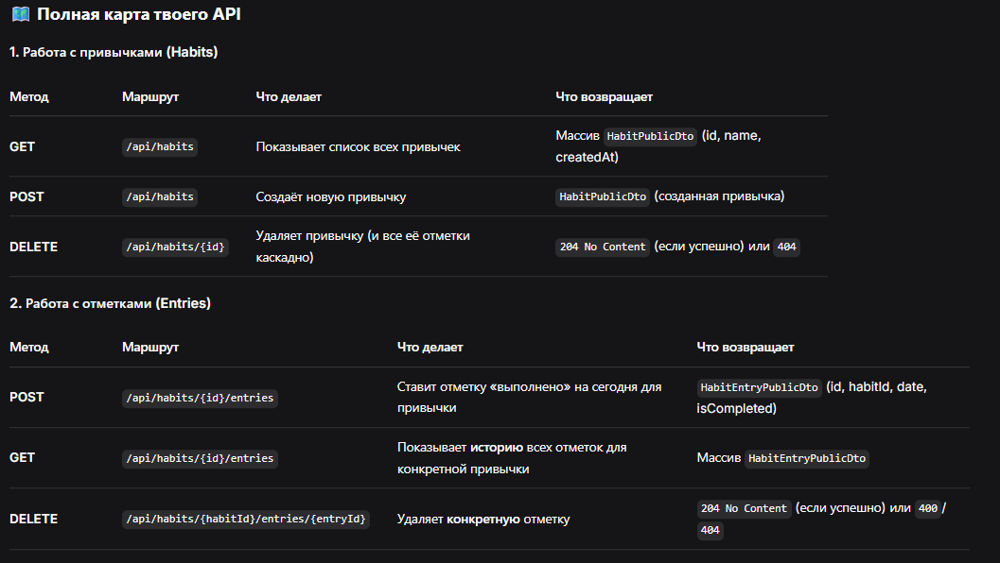

# HabitTracker
Решил, что будет полезно для себя иметь такое описание.
Models/ - Сущности базы данных. Только свойства, никакой логики. (Habit, HabitEntry).
Dtos/ - Объекты для общения с клиентом. (HabitCreateDto, HabitPublicDto).
Data/ - Контекст базы (AppDbContext).
Repositories/ - Только LINQ-запросы к базе. (IHabitRepository, HabitRepository).
Services/ - Правила и логика. (IHabitService, HabitService, HabitAlreadyExistsException).
Controllers/ - Прием HTTP-запросов и отдача HTTP-ответов. (HabitsController).
# DAY 1
Всё в контроллере, без сервисов и репозиториев. Добавление сущностей, контекста базы данных, DTO, контроллера и миграций.
# DAY 2
Рефакторинг, вынос из контроллера кода в сервисы и репозитории. Добавление проверки на существование привычки при добавлении новой привычки. Добавление исключения HabitAlreadyExistsException.
# DAY 3
Сюда будет добавлено ещё что-то. Допишу завтра. Дописал в дне 4.
# DAY 4
Обновление привычки. Добавление метода Update в репозиторий и сервис. Добавление проверки на существование привычки.
Удаление привычки полностью. Добавление дашбоарда, удаление отметки. Добавил историю. 
# Лень писать, что я добавляю по дням, потому что это уже не имеет смысла. Просто буду писать, что я добавил. Если захочу. Я просто смотрю как что работает в этом фреймворке, особо над тем, что кто и когда это будет читать даже не думаю. Кроме меня, поэтому и оставляю комментарии здесь.
# Следующий проект уже будет более "взрослым" и "правильным".
